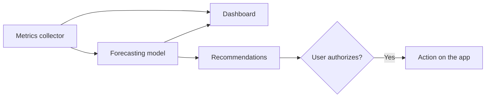

<h1 align="center">
  
</h1>

<p align="center">
  <strong>Embedded machine learning to anticipate memory pressure on macOS.</strong>
</p>

<p align="center">
  
  
  
</p>

<p align="center">
  <strong>English</strong> | <a href="README.pt-BR.md">Português (Brasil)</a>
</p>

> [!WARNING]
> AppSlicerOS is in early development. The project currently contains the machine
> learning library, a terminal collector that feeds it with real readings, and a first
> version of the interface. There is no installable app yet, so it runs from the source.

## Table of contents

- [About](#about)
- [Principles](#principles)
- [Architecture](#architecture)
- [Getting started](#getting-started)
- [Using the library](#using-the-library)
- [Project structure](#project-structure)
- [Roadmap](#roadmap)
- [Development workflow](#development-workflow)
- [License](#license)

## About

macOS already manages system memory, and no app can take over that job. That is why
AppSlicerOS does not promise to "clean" your RAM, a practice that tends to discard
useful cache and slow the Mac down.

The goal is different: learn how each Mac is used, predict periods of memory pressure,
and help the user act before the system slows down. A clean, modern interface with a
real-time dashboard will make all of this visible and easy to control.

## Principles

- **Local processing:** usage data and training stay on the Mac.
- **Low overhead:** the target is under 100 MB of RAM and under 2% average CPU.
- **User control:** no app will be closed without authorization.
- **Clean, intuitive interface:** a modern native design, with plain language, clear
  explanations, and accessibility built in.
- **Measurable results:** success means less time under pressure and less swap growth,
  not more free memory.

## Architecture

The diagram shows the planned system. The metrics collector, the forecasting model, and
the dashboard are implemented so far.



The project is written in pure Swift, with no external dependencies. `AppSlicerML`
contains the model, and `AppSlicerMetrics` reads the system's memory metrics:

| Component | Purpose |
| --- | --- |
| `RunningStandardizer` | Normalizes metrics incrementally using Welford's algorithm. |
| `OnlineLogisticRegression` | Classifies with logistic regression, learning from each sample with AdaGrad. |
| `EWMAAnomalyDetector` | Detects sudden deviations in a metric using an exponential moving average. |
| `PressureForecaster` | Estimates the probability of elevated pressure within a time horizon. |
| `ForecasterStore` | Saves and restores the model so learning continues across restarts. |
| `SystemMemoryReader` | Reads pressure, memory usage, compression, swap, and paging. |
| `ProcessMemoryReader` | Reads the memory footprint of each process. |
| `HistoryStore` | Keeps system-wide memory history in a local SQLite database. |

## Getting started

### Prerequisites

- macOS 13 or later
- Swift 6, included with the Command Line Tools (Xcode is not required)

So far, the project has only been built and tested on an Intel Mac running macOS 15.

### Installation

```sh
git clone https://github.com/Filip3Owl/AppSlicerOS.git
cd AppSlicerOS
swift build
```

### Running the app

```sh
swift run appslicer-app
```

The app opens a window and adds an item to the menu bar. It reads live metrics only while
a window or the menu bar panel is showing, and it shows the history and forecasts saved
by the collector. It follows your system language, and you can try Portuguese with:

```sh
swift run appslicer-app -AppleLanguages '(pt-BR)'
```

### Running the collector

The collector prints live memory metrics and forecasts to the terminal, while the model
learns from each reading:

```sh
swift run appslicer-collector --interval 2 --top 5
```

```text
17:45:18  pressure: normal
  memory:  5.79 GB used of 8.00 GB (72%)
           app 1.82 GB, wired 2.03 GB, compressed 1.94 GB
           cached 1.53 GB, free 0.77 GB
  swap:    2.79 GB used of 4.00 GB, pageouts -
  forecast: learning (0/20 elevated pressure examples, 0/20 calm examples)
  top processes:
    0.79 GB  Google Chrome Helper (Renderer) (3141)
```

Press `Ctrl-C` to stop, or run `swift run appslicer-collector --help` to see all
options. Without root, the collector cannot read the processes of other users, such as
many system services.

The model needs real examples before it can forecast: each reading becomes an example
only after the 10-minute horizon, and it must see both calm and elevated pressure. On a
Mac that rarely reaches elevated pressure, this can take a long time.

The model is saved every 5 minutes and on exit, then restored on the next run. The file
contains only model values and recent system-wide metrics, without app names, and
nothing is sent anywhere.

Each reading is also added to a local history, which holds system-wide metrics only.
Full readings are kept for 7 days, then summarized by minute and kept for 90 days. At
one reading every 2 seconds, this takes about 40 MB of disk space. To inspect it:

```sh
sqlite3 ~/Library/Application\ Support/AppSlicerOS/history.sqlite \
  "SELECT pressure_level, COUNT(*) FROM readings GROUP BY pressure_level;"
```

To delete everything the collector has stored, stop it and remove the
`~/Library/Application Support/AppSlicerOS/` folder.

### Tests

```sh
swift test
```

The model tests use synthetic data. They validate its learning and rules, but they do
not measure its accuracy in real use. The metrics tests also read the real system to
check that the values are plausible.

## Using the library

Pass in a memory sample at each reading. The model learns on its own as the outcome of
each sample becomes known.

```swift
import AppSlicerML
import Foundation

var forecaster = PressureForecaster()

let sample = MemorySample(
    timestamp: Date().timeIntervalSince1970,
    usedFraction: 0.72,
    compressedFraction: 0.18,
    swapUsedFraction: 0.35,
    pageoutsPerSecond: 12,
    isPressureElevated: false
)

if let probability = forecaster.observe(sample) {
    print("Chance of elevated pressure: \(Int(probability * 100))%")
} else {
    print("The model is still learning.")
}
```

The default horizon is 10 minutes. Forecasts are published only after 20 examples of
each class, with and without elevated pressure. Both values can be changed in
`PressureForecaster.Configuration`.

### Saving the model

Use `ForecasterStore` to keep what the model has learned between runs:

```swift
import AppSlicerML

let store = ForecasterStore(fileURL: try ForecasterStore.defaultFileURL())
var forecaster = try store.load(configuration: PressureForecaster.Configuration())

// Observe samples, then save periodically and before quitting.
try store.save(forecaster)
```

The model is stored in `~/Library/Application Support/AppSlicerOS/`, readable only by
the current user. If the file is missing, corrupted, or from an incompatible version
or configuration, the model starts over.

## Project structure

```text
AppSlicerOS/
├── Package.swift              # Swift package definition
├── README.md                  # Documentation in English
├── README.pt-BR.md            # Documentation in Brazilian Portuguese
├── Sources/
│   ├── AppSlicerApp/          # SwiftUI interface
│   ├── AppSlicerCollector/    # Terminal metrics collector
│   ├── AppSlicerHistory/      # Local SQLite history
│   ├── AppSlicerML/           # Machine learning algorithms
│   └── AppSlicerMetrics/      # System memory readings
├── Tests/                     # Automated tests for each module
└── docs/
    └── assets/                # Logo and other images
```

## Roadmap

This is an initial roadmap and may change as the project produces real data.

### Phase 1: machine learning core

- [x] Incremental metric normalization
- [x] Logistic regression with online learning
- [x] Anomaly detector
- [x] Memory pressure forecasting
- [x] Tests with synthetic data
- [x] Save and restore the model on disk

### Phase 2: metrics collection

- [x] Read system pressure, compression, swap, and paging
- [x] Measure memory consumption per process
- [x] Teach the model from live readings
- [x] Group helper processes into their apps
- [x] Store history locally in SQLite
- [x] Define a data retention policy

### Phase 3: app interface and real-time dashboard

- [x] Prototype and validate the interface
- [x] Build the main window with sidebar navigation in SwiftUI
- [x] Add a menu bar item for a quick glance and common actions
- [x] Display real-time charts with Swift Charts
- [x] List the apps using the most memory
- [x] Show the model's forecast and learning status in plain language
- [x] Support light and dark mode
- [x] Localize the interface in English and Brazilian Portuguese
- [ ] Verify VoiceOver and keyboard navigation
- [ ] Measure the interface against the RAM and CPU targets in prolonged use

### Phase 4: validation with real data

- [ ] Compare the model against fixed-threshold alerts
- [ ] Measure forecast accuracy in real use
- [ ] Verify the RAM and CPU targets

### Phase 5: recommendations and actions

- [ ] Identify idle apps that can be closed
- [ ] Send alerts ahead of pressure spikes
- [ ] Close apps upon user confirmation
- [ ] Allow automation only for authorized apps
- [ ] Block actions on system processes

### Phase 6: distribution

- [x] Set up continuous integration with GitHub Actions
- [ ] Sign and notarize the app with Developer ID
- [ ] Publish the first release

## Development workflow

- The `main` branch must stay stable; work happens on short-lived branches such as
  `feat/...`, `fix/...`, `docs/...`, and `chore/...`.
- Changes reach `main` through pull requests, with passing tests.
- Commits follow the [Conventional Commits](https://www.conventionalcommits.org/)
  specification.
- Usage data, trained models, and secrets never enter the repository.
- `README.md` is the primary documentation, and `README.pt-BR.md` must be kept in sync
  with it.

## License

This project does not have a license yet. Until one is chosen, all rights are reserved
by the author.
