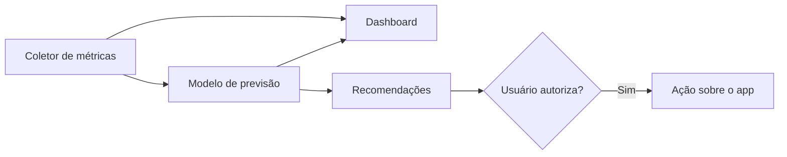

<h1 align="center">
  
</h1>

<p align="center">
  <strong>Machine learning embutido para antecipar a pressão de memória no macOS.</strong>
</p>

<p align="center">
  
  
  
</p>

<p align="center">
  <a href="README.md">English</a> | <strong>Português (Brasil)</strong>
</p>

> [!WARNING]
> O AppSlicerOS está no início do desenvolvimento. Hoje, o projeto contém apenas a
> biblioteca de machine learning. Ainda não existe um aplicativo para instalar.

## Índice

- [Sobre o projeto](#sobre-o-projeto)
- [Princípios](#princípios)
- [Arquitetura](#arquitetura)
- [Primeiros passos](#primeiros-passos)
- [Como usar a biblioteca](#como-usar-a-biblioteca)
- [Estrutura do projeto](#estrutura-do-projeto)
- [Roadmap](#roadmap)
- [Fluxo de desenvolvimento](#fluxo-de-desenvolvimento)
- [Licença](#licença)

## Sobre o projeto

O macOS já gerencia a memória do sistema, e nenhum aplicativo pode assumir esse
controle. Por isso, o AppSlicerOS não promete "limpar" a RAM, prática que costuma
descartar cache útil e deixar o Mac mais lento.

O objetivo é outro: aprender como cada Mac é usado, prever momentos de pressão de
memória e ajudar o usuário a agir antes que o sistema fique lento. Uma interface limpa
e moderna, com dashboard em tempo real, tornará tudo isso visível e fácil de controlar.

## Princípios

- **Processamento local:** os dados de uso e o treinamento ficam no próprio Mac.
- **Leveza:** a meta é consumir menos de 100 MB de RAM e menos de 2% de CPU em média.
- **Controle do usuário:** nenhum app será fechado sem autorização.
- **Interface limpa e intuitiva:** design nativo e moderno, com linguagem simples,
  explicações claras e acessibilidade desde o início.
- **Resultados mensuráveis:** o sucesso é medido por menos tempo sob pressão e menos
  crescimento do swap, não pela quantidade de memória livre.

## Arquitetura

O diagrama mostra o sistema planejado. Por enquanto, apenas o modelo de previsão está
implementado.



A biblioteca `AppSlicerML` é escrita em Swift puro, sem dependências externas:

| Componente | Função |
| --- | --- |
| `RunningStandardizer` | Normaliza as métricas de forma incremental, pelo algoritmo de Welford. |
| `OnlineLogisticRegression` | Classifica por regressão logística, aprendendo a cada amostra com AdaGrad. |
| `EWMAAnomalyDetector` | Detecta desvios bruscos em uma métrica por média móvel exponencial. |
| `PressureForecaster` | Estima a probabilidade de pressão elevada dentro de um horizonte de tempo. |
| `ForecasterStore` | Salva e restaura o modelo para que o aprendizado continue após reinícios. |

## Primeiros passos

### Pré-requisitos

- macOS 13 ou superior
- Swift 6, incluído nas Command Line Tools (o Xcode não é obrigatório)

Até agora, o projeto foi compilado e testado apenas em um Mac Intel com macOS 15.

### Instalação

```sh
git clone https://github.com/Filip3Owl/AppSlicerOS.git
cd AppSlicerOS
swift build
```

### Testes

```sh
swift test
```

Os testes usam dados sintéticos. Eles validam o aprendizado e as regras do modelo,
mas não medem sua precisão em uso real.

## Como usar a biblioteca

Envie uma amostra de memória a cada leitura. O modelo aprende sozinho à medida que os
resultados de cada amostra se tornam conhecidos.

```swift
import AppSlicerML
import Foundation

var forecaster = PressureForecaster()

let sample = MemorySample(
    timestamp: Date().timeIntervalSince1970,
    usedFraction: 0.72,
    compressedFraction: 0.18,
    swapUsedFraction: 0.35,
    pageoutsPerSecond: 12,
    isPressureElevated: false
)

if let probability = forecaster.observe(sample) {
    print("Chance de pressão elevada: \(Int(probability * 100))%")
} else {
    print("O modelo ainda está aprendendo.")
}
```

O horizonte padrão é de 10 minutos. As previsões só são publicadas depois de 20
exemplos de cada classe, com e sem pressão elevada. Ambos os valores podem ser
alterados em `PressureForecaster.Configuration`.

### Como salvar o modelo

Use o `ForecasterStore` para manter o que o modelo aprendeu entre as execuções:

```swift
import AppSlicerML

let store = ForecasterStore(fileURL: try ForecasterStore.defaultFileURL())
var forecaster = try store.load(configuration: PressureForecaster.Configuration())

// Envie as amostras e salve periodicamente e antes de encerrar.
try store.save(forecaster)
```

O modelo fica em `~/Library/Application Support/AppSlicerOS/`, com leitura restrita ao
usuário atual. Se o arquivo estiver ausente, corrompido ou for de uma versão ou
configuração incompatível, o modelo recomeça do zero.

## Estrutura do projeto

```text
AppSlicerOS/
├── Package.swift              # Definição do pacote Swift
├── README.md                  # Documentação em inglês
├── README.pt-BR.md            # Documentação em português do Brasil
├── Sources/
│   └── AppSlicerML/           # Algoritmos de machine learning
├── Tests/
│   └── AppSlicerMLTests/      # Testes automatizados
└── docs/
    └── assets/                # Logo e demais imagens
```

## Roadmap

O roadmap é inicial e pode mudar à medida que o projeto gerar dados reais.

### Fase 1: núcleo de machine learning

- [x] Normalização incremental das métricas
- [x] Regressão logística com aprendizado online
- [x] Detector de anomalias
- [x] Previsão de pressão de memória
- [x] Testes com dados sintéticos
- [x] Salvar e restaurar o modelo em disco

### Fase 2: coleta de métricas

- [ ] Ler pressão, compressão, swap e paginação do sistema
- [ ] Medir o consumo de memória por app
- [ ] Guardar o histórico localmente em SQLite
- [ ] Definir uma política de retenção dos dados

### Fase 3: interface do app e dashboard em tempo real

- [ ] Prototipar e validar a interface
- [ ] Criar a janela principal com barra lateral em SwiftUI
- [ ] Adicionar um item na barra de menus para consulta rápida e ações comuns
- [ ] Exibir gráficos em tempo real com Swift Charts
- [ ] Listar os apps que mais consomem memória
- [ ] Mostrar a previsão do modelo e o estado do aprendizado em linguagem simples
- [ ] Oferecer temas claro e escuro, VoiceOver e navegação por teclado
- [ ] Traduzir a interface para inglês e português do Brasil

### Fase 4: validação com dados reais

- [ ] Comparar o modelo com alertas baseados em limites fixos
- [ ] Medir a precisão das previsões em uso real
- [ ] Verificar as metas de consumo de RAM e CPU

### Fase 5: recomendações e ações

- [ ] Identificar apps ociosos que podem ser fechados
- [ ] Enviar alertas antes dos picos de pressão
- [ ] Fechar apps mediante confirmação do usuário
- [ ] Permitir automação apenas para apps autorizados
- [ ] Bloquear ações sobre processos do sistema

### Fase 6: distribuição

- [x] Configurar integração contínua com GitHub Actions
- [ ] Assinar e notarizar o app com Developer ID
- [ ] Publicar a primeira versão

## Fluxo de desenvolvimento

- A branch `main` deve permanecer estável; o trabalho acontece em branches curtas,
  como `feat/...`, `fix/...`, `docs/...` e `chore/...`.
- As mudanças entram na `main` por pull request, com os testes passando.
- Os commits seguem o padrão
  [Conventional Commits](https://www.conventionalcommits.org/pt-br/).
- Dados de uso, modelos treinados e segredos nunca entram no repositório.
- O `README.md` é a documentação principal, e o `README.pt-BR.md` deve acompanhar
  suas alterações.

## Licença

Este projeto ainda não tem uma licença definida. Até lá, todos os direitos são
reservados ao autor.
